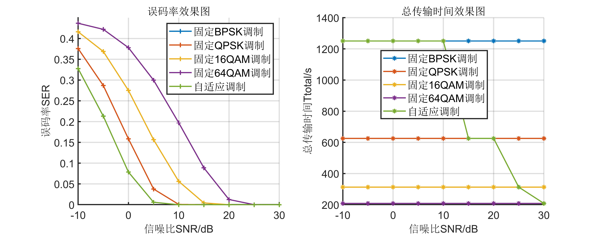

# Adaptive modulation and coding in time-varying fading channels using MATLAB code

In mobile communication systems, due to the characteristics of wireless time-varying fading channels, there is a significant amount of uncertainty in the communication process. Adaptive methods enhance transmission rates or reduce transmit power when channel conditions are favorable, and decrease rates or increase power when channel conditions are poor. Simulation results demonstrate that systems adaptively modulated based on channel quality can maintain low error rates while increasing system transmission rates, thereby enhancing transmission reliability and improving frequency band utilization efficiency.
\n        \n  
  

## Images

<!-- PAYMENT_BLOCK -->

## Get this dataset

- Payment link (Stripe): [Buy now](https://buy.stripe.com/3cs8yP7sY87d0vu9AB)
- Payment QR code: 

<!-- /PAYMENT_BLOCK -->
